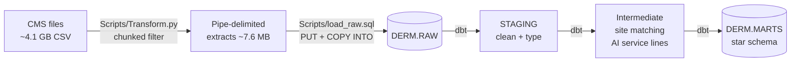

# Dermatology Market Data Pipeline

An end-to-end pipeline that turns two large CMS public datasets into a tested, analysis-ready view of
the dermatology market across nine states: who the providers are, which practices and sites they work
at, what procedures they perform, and what Medicare pays for them.

**Stack:** Python (pandas) · Snowflake · dbt · Snowflake Cortex (`AI_CLASSIFY`)

## At a glance

| | |
|---|---|
| Source data | ~4.1 GB of raw CMS files (2 datasets) |
| Loaded to Snowflake | ~7.6 MB after filtering (dermatology + Mohs, 9 states) |
| Providers | 1,955 |
| Group practices | 495 (115 with more than one site), plus 347 independent or unlisted providers |
| Practice sites | 1,084 |
| Procedure codes | 317, each classified into a service line |
| Medicare services / payments | 8.4M services · $515.5M paid (2024) |
| Data tests | 28, all passing |

States: TN, KY, VA, NC, GA, AL, MS, AR, MO, grouped into four regions (Central, East, South, West).

## Pipeline



1. **Extract** ([Scripts/Transform.py](Scripts/Transform.py)): reads both CMS files in 100,000-row chunks,
   keeps dermatology and Mohs surgery providers in the nine states, and writes pipe-delimited extracts.
   Prints row counts per state and specialty for reconciliation.
2. **Load** ([Scripts/load_raw.sql](Scripts/load_raw.sql)): stages the extracts in Snowflake and copies
   them into `RAW` tables, then checks the row counts match the extract.
3. **Transform** ([derm_dbt/](derm_dbt/)): dbt builds staging views, intermediate logic and a star
   schema in `MARTS`, and tests every layer.

## Data model

`fct_services` holds one row per **provider × procedure code × place of service** (36,942 rows),
with service counts and Medicare dollar totals.

| Dimension | Grain | Notes |
|---|---|---|
| `dim_provider` | NPI | Includes how the provider's site was matched |
| `dim_practice` | CMS group (PAC ID) | Provider and site counts per practice |
| `dim_location` | Practice address | City, state, ZIP and region |
| `dim_service` | Procedure code (HCPCS) | Description, drug flag and AI-assigned service line |

## Design decisions

**Filter before loading.** The source files are 3.3 GB and 900 MB, but only about 0.2% of the
data is relevant. Filtering in Python with chunked reads keeps memory flat no matter how big the file is,
and loads ~7.6 MB into Snowflake instead of 4 GB.

**Exact matches, not keyword search.** Searching for "derm" also matches names like McDermott and
"Scleroderma" programs. The filter matches the exact CMS specialty values instead, checked
against the values that actually appear in both full files.

**Land raw data as text.** Every `RAW` column is `VARCHAR` and the extract reads everything as strings,
so NPIs and ZIP codes keep their leading zeros and a bad value never fails the load. Typing, trimming
and renaming happen in the dbt staging models.

**Matching providers to practice sites.** The billing data has one address per provider, but the CMS
directory lists a clinician once per group and address, so there can be many candidates. The
[int_provider_site](derm_dbt/models/intermediate/int_provider_site.sql) model picks one in order of
preference, and records which rule was used so every assignment can be audited:

| Rule | Providers |
|---|---|
| Directory site at the provider's billing ZIP | 1,417 |
| No ZIP match: prefer a group, then the larger group | 364 |
| Not in the directory: fall back to the billing address | 174 |

**AI service lines, with rules where they matter.** The 317 procedure codes are grouped into six service
lines with Snowflake Cortex `AI_CLASSIFY`. The model is incremental, so each code is classified once and
rebuilds don't call the model again unless new codes appear.

Reviewing the output turned up a misclassification: the AI labeled Mohs surgery (codes 17311–17315) as
"Biopsy and pathology", because the CMS descriptions mention microscopic examination. Code 17311
is the single highest-paid code in the data ($79.7M), so `dim_service` applies a rule for those codes before falling back
to the AI label, records which one was used (`service_line_source`), and a test keeps the rule from regressing.

| Service line | Medicare paid | Services |
|---|---|---|
| Skin cancer surgery | $202.5M | 0.64M |
| Office visits | $110.0M | 1.77M |
| Lesion destruction | $84.9M | 3.54M |
| Biopsy and pathology | $47.0M | 0.94M |
| Drugs and injections | $41.4M | 1.23M |
| Other | $29.6M | 0.28M |

**Dollar totals.** CMS publishes *averages* per service. The fact table stores
`average × number of services` so totals can be summed across any dimension.

**Testing.** 28 dbt tests cover keys (unique, not null), allowed values, relationships between the fact
and every dimension, and two custom tests:
[assert_fct_reconciles_to_staging](derm_dbt/tests/assert_fct_reconciles_to_staging.sql) fails if the
fact table loses any rows or dollars relative to staging, and
[assert_mohs_codes_are_skin_cancer_surgery](derm_dbt/tests/assert_mohs_codes_are_skin_cancer_surgery.sql)
guards the service-line rule. Row counts are also checked end to end:
the extract, `RAW` and `fct_services` all hold 36,942 service rows.

## Known limitations

- **Medicare only.** The data covers Medicare Part B fee-for-service, not commercial insurance. CMS also
  suppresses rows with fewer than 11 beneficiaries, so low-volume procedures are under-counted.
- **One site per provider.** 113 clinicians belong to more than one group; each is assigned to a single
  practice site.
- **AI labels are spot-checked, not fully reviewed.** The highest-dollar codes were checked by hand,
  which is how the Mohs issue was found; the long tail of low-volume codes relies on the AI label.
- **Single year.** `data_year` is fixed at 2024; a second year would need the year carried from the source.

## Running it

**Prerequisites:** Python 3.11, a Snowflake account with Cortex enabled, and the
[Snowflake CLI](https://docs.snowflake.com/en/developer-guide/snowflake-cli/index) (for `PUT`).

```bash
python -m venv .venv
.venv\Scripts\activate          # Windows; use source .venv/bin/activate elsewhere
pip install -r requirements.txt
```

1. Download the two source files into `Data/`:
   - [Medicare Physician & Other Practitioners – by Provider and Service](https://data.cms.gov/provider-summary-by-type-of-service/medicare-physician-other-practitioners/medicare-physician-other-practitioners-by-provider-and-service) (2024)
   - [Doctors and Clinicians National Downloadable File](https://data.cms.gov/provider-data/dataset/mj5m-pzi6)
2. Extract: `python Scripts/Transform.py`
3. Load: update the file paths in `Scripts/load_raw.sql`, then `snow sql -f Scripts/load_raw.sql`
4. Add a dbt profile at `~/.dbt/profiles.yml` (key-pair authentication, so no password is stored):

   ```yaml
   derm_dbt:
     target: dev
     outputs:
       dev:
         type: snowflake
         account: <account_identifier>
         user: <user>
         private_key_path: <path/to/rsa_key.p8>
         role: <role>
         warehouse: <warehouse>
         database: DERM
         schema: STAGING
         threads: 4
   ```

5. Build and test: `cd derm_dbt && dbt build`

## Repository layout

```
├── Scripts/
│   ├── Transform.py          # extract: chunked filter of the CMS files
│   └── load_raw.sql          # load: stage, copy into RAW, reconcile counts
├── derm_dbt/
│   ├── models/
│   │   ├── staging/          # rename, type, trim (views)
│   │   ├── intermediate/     # site matching, AI service lines
│   │   └── marts/            # fact + dimension tables
│   ├── seeds/                # state → region mapping
│   ├── tests/                # custom tests (reconciliation, Mohs rule)
│   └── macros/               # schema naming override
└── requirements.txt
```

`Data/` and `Output/` are git-ignored: the source files are public but too large for the repo.
